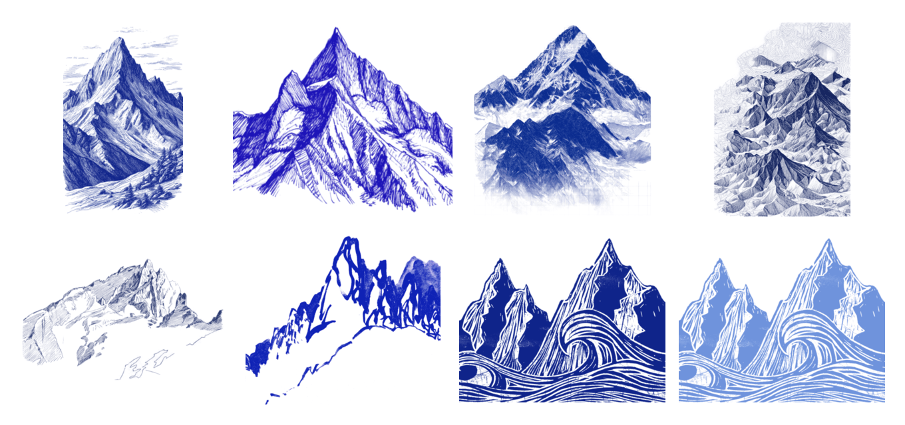

Eight blue mountains, cut out of their paper and ready to drop onto any page: pen-and-ink peaks and ridges, a brush-and-wash ridge, a range with drifting contour lines, a 1934 sketch, and a linocut of peaks over curling waves. Each comes in the blue it was drawn in, cobalt and black, as a transparent PNG. The linocut also has lighter blues and an SVG. They are a candidate look for a sub-brand. See every version in the [mountains gallery](https://sor-design-system-rufuspollock.flowershow.me/system/mountains/gallery.html) (rules: [graphics](https://sor-design-system-rufuspollock.flowershow.me/graphics#mountains)).

