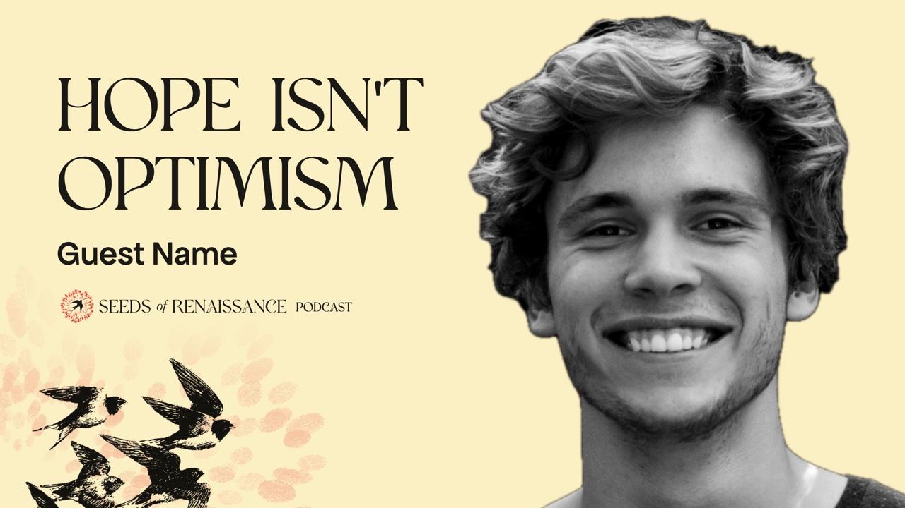

Seeds of Renaissance podcast episodes now have their cover: the guest on the right, the episode's sharpest line and the guest's name on the left, and our swallows rising from the bottom-left corner through faint red fingerprints from the logo, all on our pale sunlight yellow. The podcast's square show art and per-episode art follow the same look. The same look carries over to Instagram, with templates for episode posts, quote cards, announcements, statements and carousels. Both come as Canva kits with ready-made layers and step-by-step instructions, so anyone on the team can make a new one: [Podcast](https://sor-design-system-rufuspollock.flowershow.me/podcast) · [Instagram posts](https://sor-design-system-rufuspollock.flowershow.me/examples/social/instagram/index.html).

