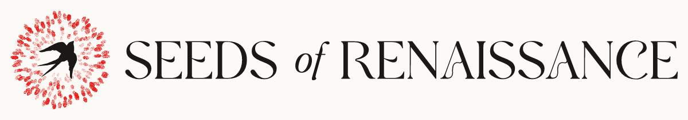

The Seeds of Renaissance logo is settled: our swallow, now with a hand-cut, printed edge and set bigger in its ring of red fingerprints, beside the name in Polyamine with a small italic "of". It comes in five colourways for light and dark grounds and five layouts, from the horizontal logo to the mark alone at favicon size. Every file is on one page, ready to use: [Logos](https://sor-design-system-rufuspollock.flowershow.me/logos.html) (rules: [logo](https://sor-design-system-rufuspollock.flowershow.me/logo)).

