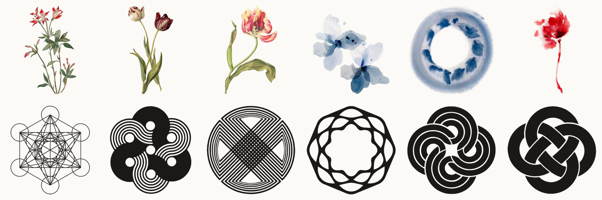

Thirty-four new graphic elements for the design system, cut out of their paper and ready to drop onto any page, in four sets: coloured botanicals (a tulip, an orchid, a scroll painting of peaches, a single green flower), loose watercolour and ink washes, black line geometry such as an exact Metatron's cube, and interlaced marks and patterns. Each is a transparent PNG, with an SVG where it is small and clean. The botanicals and washes keep the colours they were painted in; the geometry and marks are plain black. See each set in its gallery: [botanicals](https://sor-design-system-rufuspollock.flowershow.me/system/botanicals/gallery.html), [washes](https://sor-design-system-rufuspollock.flowershow.me/system/washes/gallery.html), [geometry](https://sor-design-system-rufuspollock.flowershow.me/system/geometry/gallery.html) and [marks](https://sor-design-system-rufuspollock.flowershow.me/system/marks/gallery.html) (rules: [graphics](https://sor-design-system-rufuspollock.flowershow.me/graphics#botanicals)).

