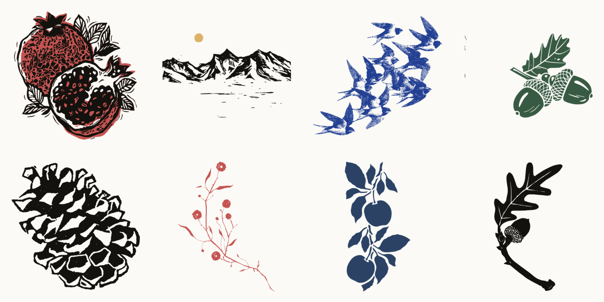

Seventeen woodcut, linocut and engraving prints for the design system, in thirty versions, cut out of their paper and ready to drop onto any page: pomegranates in black and red, oak leaves and acorns, pinecones, hanging fruit, flowers, a mountain range with and without a gold sun, and a rising flock of swallows. Each is an SVG and a transparent PNG, and keeps the colours it was printed in, so it can sit under a soft transparency. See them all in the [prints gallery](https://sor-design-system-rufuspollock.flowershow.me/system/prints/gallery.html) (rules: [graphics](https://sor-design-system-rufuspollock.flowershow.me/graphics#prints)).

