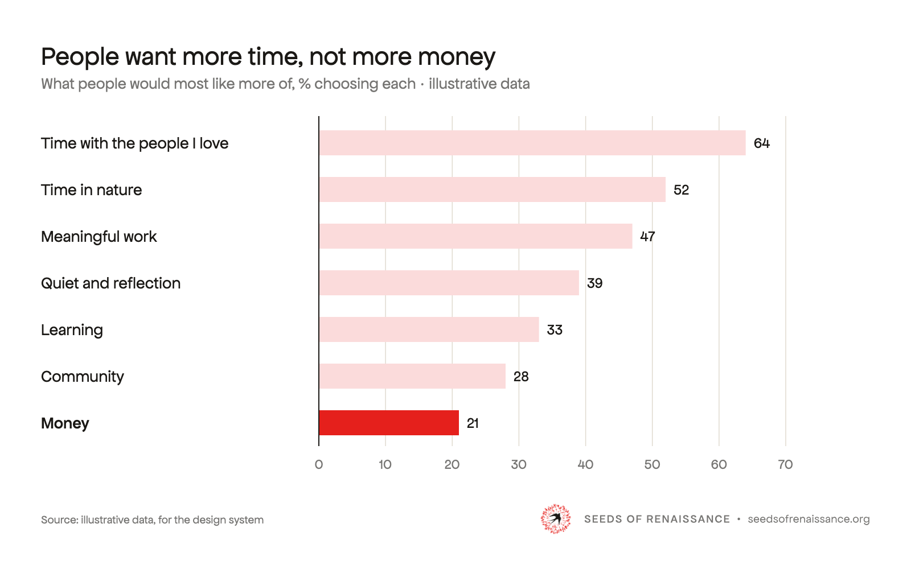
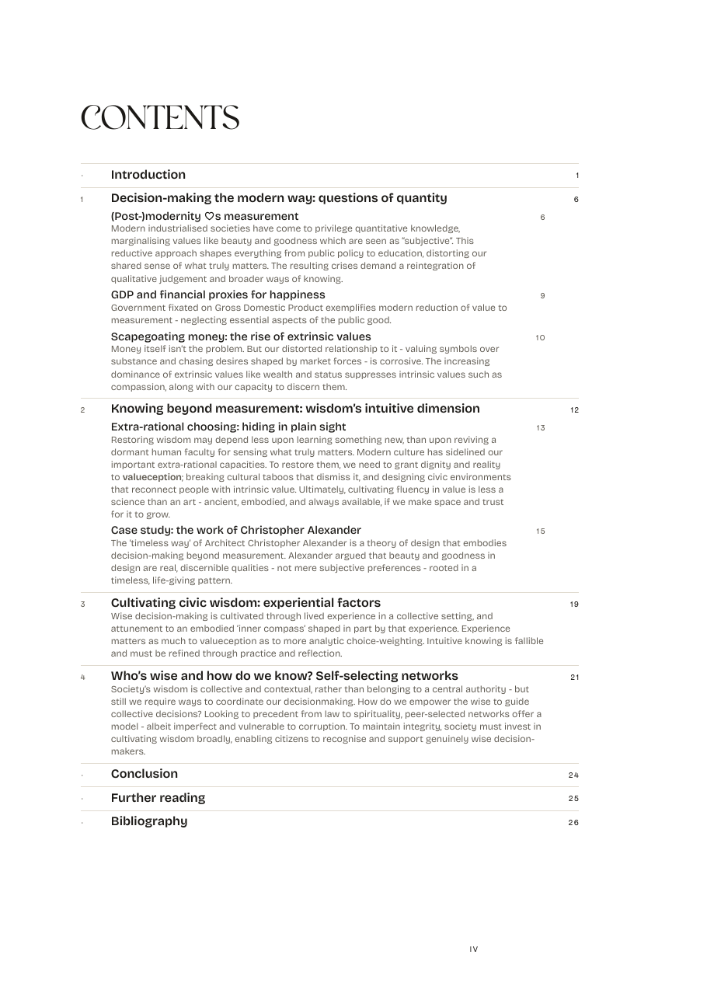

# Examples

Whole pages and assets built only from the system: the test that the system is complete, and the thing to copy. To make something new, copy the closest example and follow [BUILD.md](BUILD.md). Part of the [SoR design system](README.md).

## By kind

Each kind has a guide (how to make it) and examples to copy. Each has its own folder under `examples/`.

| Kind | Guide | Examples |
|---|---|---|
| **Website** | [website.md](website.md) | [Six pages](#website) |
| **YouTube** | [youtube.md](youtube.md) | [Thumbnails](examples/youtube/index.html) · [channel art](examples/youtube/channel.html) |
| **Podcast** | [podcast.md](podcast.md) | [Podcast kit](examples/youtube/canva-kit/README.md) · [show art](examples/podcast/README.md) |
| **Social media** | [social.md](social.md) | [Instagram kit](examples/social/instagram/README.md) |
| **Slides** | [slides.md](slides.md) | [Study and Gathering decks](examples/slides/index.html) |
| **Print** | [print.md](print.md) | [The Wisdom paper](examples/print/index.html) |
| **Diagrams** | [diagrams.md](diagrams.md) | [Figures and charts](examples/diagrams/index.html) |

Email has a guide, [email.md](email.md), but no template yet.

Photographs in the examples are placeholders ([photography.md](photography.md)). Polyamine and Restora are not yet licensed: nothing public, PDFs and Canva included, until they are.

## Website

Pages for the Seeds of Renaissance website, one per register.

<iframe class="specimen" src="specimens/examples-web.html" style="aspect-ratio:1000/1400" loading="lazy" title="Website examples"></iframe>

| Example | Register |
|---|---|
| [Home](examples/web/home.html) | Landing page |
| [Manifesto](examples/web/manifesto.html) | Long reading |
| [Gatherings](examples/web/gatherings.html) | Events and community |
| [Join](examples/web/join.html) | Joining |
| [Magazine](examples/web/magazine.html) | Publication |
| [White paper](examples/web/white-paper.html) | Research |

## YouTube

Thumbnails, podcast covers and channel art. How to make them: [youtube.md](youtube.md).

<iframe class="specimen" src="specimens/examples-youtube.html" style="aspect-ratio:1000/985" loading="lazy" title="YouTube examples"></iframe>

- [Thumbnails and podcast covers](examples/youtube/index.html), 1280×720, full size and in a feed.
- [Channel art](examples/youtube/channel.html): banner, avatar, lower third, watermark.

## Podcast

The episode cover, episode posts, show art and episode art, all on the swallows-and-fingerprints ground. How to make them: [podcast.md](podcast.md).

  
  

- [Podcast kit](examples/youtube/canva-kit/README.md): the episode cover in Canva, with PNG layers, guides and step-by-step positions. Seen with the other thumbnails in [examples/youtube/](examples/youtube/index.html).
- [Show art and episode art](examples/podcast/README.md), 3000 × 3000.
- Episode posts for Instagram are in the [Instagram kit](examples/social/instagram/README.md).

## Social

Instagram posts on the swallows-and-fingerprints ground, as a Canva kit. Rules and sizes: [social.md](social.md).

<iframe class="specimen" src="specimens/examples-social.html" style="aspect-ratio:1000/523" loading="lazy" title="Social examples"></iframe>

- [Instagram posts](examples/social/instagram/index.html): podcast episode, quote card, announcement, statement, carousel; 4:5 and 1:1. Canva kit: [README](examples/social/instagram/README.md).

## Slides

Decks on a fixed 1920 × 1080 artboard, in two registers. How to make one: [slides.md](slides.md).

- [Slide examples](examples/slides/index.html): [Study](examples/slides/study.html), fifteen slides on the Wisdom paper, and [Gathering](examples/slides/gathering.html), ten slides for a community call.

## Diagrams

Figures, frameworks and charts in the house style. How to make one: [diagrams.md](diagrams.md).

  
  
  

- [Diagram examples](examples/diagrams/index.html): the wisdom gap, polycrisis to metacrisis, and three charts (lines, ranked bars, before and after), each in light and dark, at 400px and in black and white; on a page of a paper and in a web article; and the Wisdom paper's published figures.
- Built by `examples/diagrams/build.py`, whose functions are the starting point for a new figure.

## Print

Papers as one A4 PDF, read on screen. How to make one: [print.md](print.md).

  
  
  
  

- [Print examples](examples/print/index.html): the Wisdom paper page by page (covers, title page, imprint, contents, a chapter opening, body pages with a figure, quotes and a summary box), and a link to the whole PDF.
- Built with Typst in `pdf-report-publishing` (`typst/build-paper.sh`), from the `--print-*` tokens.
