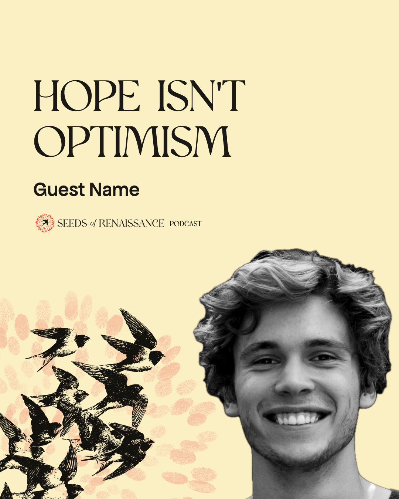

# Instagram posts: Canva kit

Templates and elements for Seeds of Renaissance Instagram posts, on the same background as the podcast thumbnail's bottom-left layout: sunlight, the black swallows rising from the bottom-left corner, the logo's fingerprints faded around them. Words sit above the birds, and the logo (mark and name, no disc) sits under the words, as on the [podcast cover](../../youtube/canva-kit/README.md) signed off on 13 October 2026. Preview: [index.html](index.html).

## Sizes

- **Portrait 4:5, 1080 × 1350**: the default for Instagram feed posts. In Canva: *Custom size*, 1080 × 1350 px, or the *Instagram Portrait Post* preset.
- **Square 1:1, 1080 × 1080**: *Instagram Post (Square)*.

Instagram's profile grid crops posts to 3:4, trimming a little off the top and bottom of a 4:5 post. Everything important sits well inside that.

## What's in the download

| Folder | Files | Use |
|---|---|---|
| `1-backgrounds` | `bg-4x5`, `bg-4x5-quiet`, and the same for `1x1` | **Start here.** The whole background in one image. *Quiet* keeps only the fingerprints, for carousel inner slides and text-heavy posts |
| `2-elements` | `element-swallows-flock-black`, `element-fingerprint-ring`, `element-fingerprint-ring-faded`, `element-logo-lockup`, `element-logo-mark` | Free-standing pieces with transparent backgrounds, to place and size yourself. The fingerprint ring is the new mark's prints without the bird. The faded ring is at the strength used in the templates (20%); with the full one, set transparency in Canva |
| `3-full-page-layers` | `layer-4x5-swallows`, `layer-4x5-fingerprints`, and the same for `1x1` | The background's pieces separately, already in position: stretch to fill the page |
| `4-guides` | `guides-…` for each template | Pink boxes showing where the words and photo go, with type sizes. Put on top while working, **delete before downloading** |
| `5-examples` | `example-…` for each template, with and without guides | For reference |

## The templates

| Template | Format | Words | Type |
|---|---|---|---|
| **Podcast episode** | 4:5, 1:1 | The guest's sharpest line, 3–6 words; the guest's name; the logo with PODCAST | Polyamine 124 px (108 square); name Apfel Grotezk Mittel 54 (48); PODCAST in Polyamine after the lockup, at the height of its capitals |
| **Quote card** | 4:5, 1:1 | A quote of up to about 20 words, and its source | Restora 84 px (72 square) for quotes over ten words; Polyamine if ten or fewer; source Apfel 30, capitals |
| **Announcement** | 4:5 | Series, a 2–4 word title, when, one line of detail | Series Apfel 30; title Polyamine 140; when Bricolage SemiBold 52; detail Bricolage 40 |
| **Statement** | 4:5, 1:1 | One line, 5–10 words | Polyamine 116 (100 square) |
| **Carousel** | 4:5 | Cover (a question), inner slides (a number and one idea), closing slide (the call to action) | Cover Polyamine 132; number Restora 240; inner text Bricolage Medium 56; close Polyamine 136 |

All text is ink `#1b1916`; secondary lines muted `#5d584f`. Left edge at x 90 for everything. **The logo** is the horizontal lockup (`element-logo-lockup.png`), 340 px wide (300 on squares and inner slides), left aligned at x 90 about 40 px under the last line of words; the guides show where.

## Make a post in Canva

1. **New design** at 1080 × 1350 (or 1080 × 1080).
2. **Background**: drag `bg-4x5.png` onto the page and choose *Set image as background*.
3. **Guides**: add the matching `guides-….png`, stretched to fill the page.
4. **Words and logo**: add `element-logo-lockup.png` and text boxes in the fonts and sizes above, inside the pink boxes, left aligned at x 90. Shorten the words rather than shrinking the type: nothing under about 36 px, so it reads on a phone.
5. **Photo** (podcast posts): upload a head-and-shoulders photo, *Edit photo → BG Remover* (Canva Pro), *Adjust → Saturation −100*, and place it in the face box, shoulders running off the bottom edge.
6. **Delete the guides**, then *Share → Download → PNG*.

For a carousel, make one design with several pages: the cover and closing slides on `bg-4x5`, the inner slides on `bg-4x5-quiet`.

## Set up once

- **Fonts in the Canva brand kit**: Polyamine and Restora (upload; they must be licensed before anything is published, beads `.2`), Bricolage Grotesque (free, Google Fonts; announcements and carousel text) and Apfel Grotezk (free, Collletttivo; names and labels). The files are in `system/fonts/`.
- **Colours**: ink `#1b1916`, muted `#5d584f`. The red comes only from the logo and the fingerprints.
- Save one design per template as a **team template**.

## Rules in short

One idea per post; five to ten words on the image at most, the rest in the caption. The logo always sits under the words. No other colours, arrows or stickers. Samples on the examples (dates, the guest photo, the carousel text) are placeholders.

## Rebuilding

`./export.sh` runs `build.py` (one page per PNG in `src/`) and screenshots each with headless Chrome into `png/`. Positions and sizes are at the top of `build.py` and in the template list `T`.
