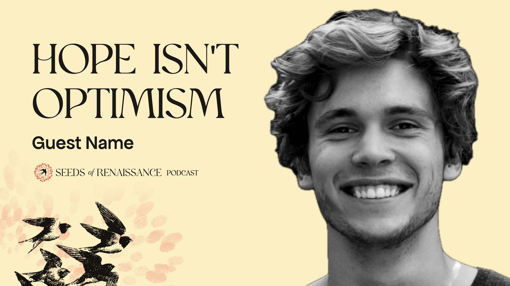

# Podcast thumbnail: Canva kit

Everything needed to make a Seeds of Renaissance podcast thumbnail in Canva: the black swallows rising from the bottom-left corner through the logo's fingerprints, faded, on sunlight; the quote, the guest's name and the logo above them; the guest on the right. Chosen 12–13 October 2026. The same ground is used for the [Instagram posts](../../social/instagram/README.md). The exploration that led here is archived in [archive/podcast-thumbnails-2026-10/](../../../archive/podcast-thumbnails-2026-10/README.md).

## What's in the kit

Every PNG is the full thumbnail size (2560 × 1440, twice 1280 × 720, so it stays sharp). Drop it in and stretch it to fill the page, and it lands in the right place.

| File | What it is | Use |
|---|---|---|
| `png/01-background.png` | Sunlight, faded fingerprints, swallows | **The usual start.** One layer for the whole background |
| `png/01-background-wash.png`, `02-background-with-logo-wash.png` | The same on a paper-to-sunlight wash | The gentler alternative: white behind the words, warm towards the bottom right |
| `png/02-background-with-logo.png` | The same with the logo already placed | Even quicker: then add only the photo and the words |
| `png/03-swallows.png` | The swallows alone, transparent | If you want to move or resize the flock |
| `png/04-fingerprints.png` | The faded fingerprints alone, transparent | The same, for the fingerprints |
| `png/05-logo.png` | The logo (mark and name), transparent | Use with 01 |
| `png/06-guest-example.png` | Where a single guest goes (placeholder photo) | Match your guest's size and position to it, then delete it |
| `png/07-two-guests-example.png` | Where two speakers go (placeholder photos) | The same, for conversations |
| `png/08-guides.png` | Pink guides: quote box, name, logo, face area, the corner to keep clear | Put it on top while you work; **delete it before downloading** |
| `png/example-one-guest.png`, `example-two-guests.png`, `example-with-guides.png` | Finished examples | For reference |

## Set up once (brand kit)

1. **Fonts.** Upload **Polyamine** (the quote) to the Canva brand kit. **Apfel Grotezk** (the name) is free (Collletttivo, OFL): upload it from `system/fonts/`. ⚠️ Polyamine must be licensed before anything is published (beads `.2`).
2. **Colours.** Ink `#1b1916` for all text. The red comes from the logo and the fingerprints.
3. **Template.** Build one thumbnail with the steps below and save it as a team template, so each episode only swaps the photo, quote and name.

## Make a thumbnail

1. **New design**: YouTube Thumbnail, 1280 × 720 px.
2. **Background**: upload `02-background-with-logo.png`, drag it onto the page and choose *Set image as background*.
3. **Guides**: add `08-guides.png` on top, stretched to fill the page.
4. **The guest**: a good photo (head and shoulders, eyes visible, mid-laugh or mid-thought rather than a neutral headshot). *Edit photo → BG Remover* (Canva Pro), then *Adjust → Saturation −100*. Place it in the face area so the head fills about three-quarters of the height and the shoulders run off the bottom edge. `06-guest-example.png` is a size guide.
   - **Two speakers**: one in front and slightly larger, the other just behind, turned towards each other (`07-two-guests-example.png`). Fade their shoulders into the white if the photo edges show.
5. **The quote**: Polyamine, ink, **112 px**, line spacing 1.0, left aligned at **x 80** (the same margin as the head's crop on the right), the top of the capitals at about **y 104** (baselines 185 and 297). Two lines, three to five words, no wider than 520 px. Shorten the quote rather than shrinking the type; pick its sharpest phrase.
6. **The name**: Apfel Grotezk Mittel, ink, **48 px** (42 px for "Name & Name"), at **x 80**, baseline about **y 375**.
7. **Check**: nothing important in the bottom-right corner (YouTube puts the video length there); the words don't touch the swallows; zoom out to about 15% and check the face and quote still read.
8. **Delete the guides**, then *Share → Download → PNG* (or JPG under 2 MB) at 1280 × 720.

## The logo

The horizontal lockup (mark and name), straight on the ground with no disc, under the guest's name at x 80, y 405, 330 px wide, with **PODCAST** after it on the same line in Polyamine at the height of the name's capitals. It's part of `02-background-with-logo.png` and `05-logo.png`, so in Canva it never needs placing by hand.

## Rules in short

- Sunlight ground (or the wash); the swallows rise from the bottom left; the fingerprints stay faint.
- One face (or two for a conversation), cut out, black and white, on the right.
- The quote is the biggest text: three to five words. Don't repeat the video title; the title says the topic, the thumbnail the hook.
- No other logos, labels or episode numbers; no arrows, shock faces or extra colours.

## Rebuilding the kit

`./export.sh` runs `build.py` (one page per layer in `src/`) and screenshots each with headless Chrome into `png/`. The ground (sunlight, swallows, fingerprints, logo) is shared with the Instagram kit in `system/swallows.py`; sizes and positions are at the top of `build.py`. The fingerprints are `system/img/fingerprints-red.png`, the new mark's prints without the bird. The guest photo is a placeholder. The swallow engraving is traced from a web image with no rights cleared: re-source or redraw it before public use.
