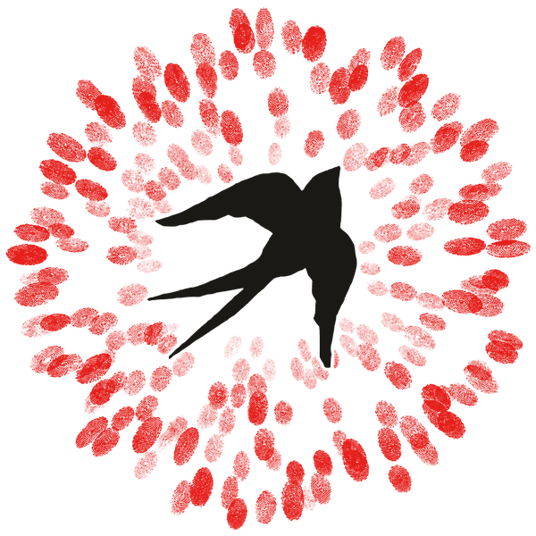

# Logo

A black swallow rising through a radiating circle of red fingerprints: many hands around a bird in flight. **Chosen 13 October 2026.** Every file, shown on its ground with links: **[logos.html](logos.html)**. Part of the [SoR design system](README.md). Earlier notes: [logo-notes.md](logo-notes.md).

<iframe class="specimen" src="specimens/logo.html" style="aspect-ratio:1000/262" loading="lazy" title="Logo, rendered"></iframe>

## Terms

- **Mark** (logomark, the stamp): the swallow in fingerprints.
- **Wordmark** (logotype): "Seeds *of* Renaissance" lettered in Polyamine, with "of" as a lowercase italic in Fraunces. Polyamine has only capitals and no italic, so a Polyamine "of" (slanted or small) looks wrong (decided 2026-10-08 on the Wisdom cover). Fraunces rather than Restora: its italic "of" looks better in the wordmark (Rufus, 2026-10-08). Fraunces is otherwise only a fallback; this one word is the exception to "four faces only". For display sizes only.
- **Lockup**: mark and wordmark fixed together, as in the site header.
- Below display size, the name is not the wordmark: it is set as text in the system's small face, Apfel Grotezk ([diagrams.md](diagrams.md#the-signature)).

## The logo (chosen 13 October 2026)

- **The mark:** the original swallow, rising left to right, kept but given a cut-and-printed edge so it no longer looks like a stock silhouette; 30% bigger in the ring than before. The fingerprints it would touch are pushed out a little, with a thin white gap around the bird, so the ring stays full.
- **The full mark at every size.** No simplified small version: the same mark from 16 px up (smaller sizes are drawn for their size, not shrunk).
- **The wordmark:** Polyamine capitals tracked +20 (font units); "of" in Fraunces italic at weight 350, optical size 101, softness 39, 115% of the cap height, raised 17% of the cap height, with 0.8 of a word space on each side. The capitals and "of" are outlines in the files, so no fonts are needed to use them.
- **The horizontal lockup** is the main logo: the mark at 2.7× the cap height, 0.35× cap height from the name. Two-line and stacked lockups are for spaces it doesn't fit.

How it was arrived at (birds tried, edges, sizes, the "of"), with the working pages: [archive/logo-2026-10/](archive/logo-2026-10/README.md).

## Files

All in [system/logo/](system/logo/README.md); see them in **[logos.html](logos.html)**.

| Use | File |
|---|---|
| The main logo | `lockups/seeds-logo-horizontal-<colourway>.svg` (or `-1200.png`, `-2400.png`) |
| Other lockups | `lockups/seeds-logo-{two-lines-left, two-lines-right, stacked, wordmark}-<colourway>` |
| The mark alone | `mark/seeds-mark-<colourway>.svg` / `.png` (1130 px) |
| Avatars, icons | `mark/sizes/seeds-mark-<colourway>-<px>.png`, 16 to 1024 px; `favicon.ico` |
| Pages and code | `system/img/logo.png` (600 px) and `logo-256.png`, the colour mark; `logo-inverted*.png`, the colour-dark mark. Same names as before, so every page picked up the new mark |

SVGs scale freely; the fingerprints inside them are sharp up to about 1130 px, enough for screens and A4 print. Larger print needs the original fingerprint artwork.

## Colourways

| Colourway | Prints, bird, name | Use on |
|---|---|---|
| `colour` | red, black, black | white, paper, sunlight |
| `colour-dark` | red, white, white | night, dark photographs |
| `black` | all black | light grounds, and the logo red; where the red would fight the page |
| `white` | all white | night, the logo red, photographs |
| `red` | all red | light grounds |

These replace the one-colour filter recipe (2026-10-08) and settle the dark-ground question: on night, use `colour-dark` or `white`, no disc needed.

## Using it

- Use the files as they are. Don't recolour, stretch, rotate or redraw them, or add effects. Choose the colourway for the ground from the table above.
- **Clear space** (proposed): at least one cap height of the wordmark on every side, and the same between the logo and the edge of the page or frame.
- **Minimum size** (proposed): below about 32 px of mark height, the name can't be read; use the mark alone.
- The **white disc** (`.logo-disc`) or a **white tile** is still fine where the mark sits on a busy photograph.
- In the site header it sits beside the wordmark, set in Polyamine with "of" in Fraunces italic (`.wordmark em` in `components.css`):

```html
<a class="wordmark" href="/"><span>Seeds <em>of</em> Renaissance</span></a>
```

- In the footer it sits above the name.
- Earlier one-colour recipe, for the record: an SVG `feColorMatrix` on `logo.png`, rows `0 0 0 0 R / 0 0 0 0 G / 0 0 0 0 B / -0.7 -0.7 -0.7 0 2`, with `color-interpolation-filters="sRGB"`. Example: the Wisdom cover, `life-itself/2rbook` `wisdom/cover/cover.html`. Prefer the `black`, `white` and `red` files now.

## Which mark where

Seeds is the brand. Life Itself, its steward and the authors' home, is credited in text. At most one logo on any surface. Reasoning: [decisions.md](decisions.md#working-through-publication-branding-2026-10-07).

| Surface | Seeds | Life Itself |
|---|---|---|
| Paper or essay cover | Series line in the wordmark face and the cover's ink, small, at the top: "Seeds *of* Renaissance · White Paper No. 6" (a bare "No. 6" doesn't say what it counts). Optionally the one-colour mark (`black`, `white` or `red`) in the cover's ink, small, centred in the bottom margin | Text, one line, one size, with the authors at the foot: "Rufus Pollock & Rosie Bell · Life Itself Sensemaking Studio" |
| Title page | The same series line | The same text credit |
| Back cover, colophon | The stacked or horizontal lockup | Its logo may appear here |
| Diagram, figure, chart | The signature: the mark (on its disc on light, `colour-dark` on dark), name and URL set in Apfel Grotezk, bottom right inside the margin ([diagrams.md](diagrams.md#the-signature)) | Not shown |
| Social crops of a cover | The mark, inside the safe area | Not shown; in the caption if needed |

## Open

1. ~~A deeper, ink-like red instead of the clean screen red.~~ Decided 2026-10-12: keep the logo red `#e5201c` ([colour.md](colour.md)).
2. ~~A hand-drawn or printmade swallow instead of the stock silhouette.~~ Decided 2026-10-13: keep the original swallow with a cut-and-printed edge (record: [archive/logo-2026-10/](archive/logo-2026-10/README.md); the earlier woodcut comparison: [archive/logo-2026-10/logo-v2-woodcut-swallows.html](archive/logo-2026-10/logo-v2-woodcut-swallows.html)).
3. ~~A small version for favicons and avatars.~~ Decided 2026-10-13: the full mark at every size, drawn for each size.
4. ~~A full set and dark grounds.~~ Done 2026-10-13: five colourways and five lockups ([logos.html](logos.html)).
5. **Polyamine licence** before public use of the wordmark (beads `design-34t.2`).
6. **Roll out beyond the design system:** the seal in `system/graphics.svg`, YouTube avatar and watermark, social avatars, the Canva kit and Instagram exports (re-export them; they hold the old mark), and the website's own copy. The site header's live wordmark still uses Fraunces at 300; match it to the settings above or use the lockup file.
7. **Larger than A4:** the original fingerprint scan or artwork, for posters and banners.
