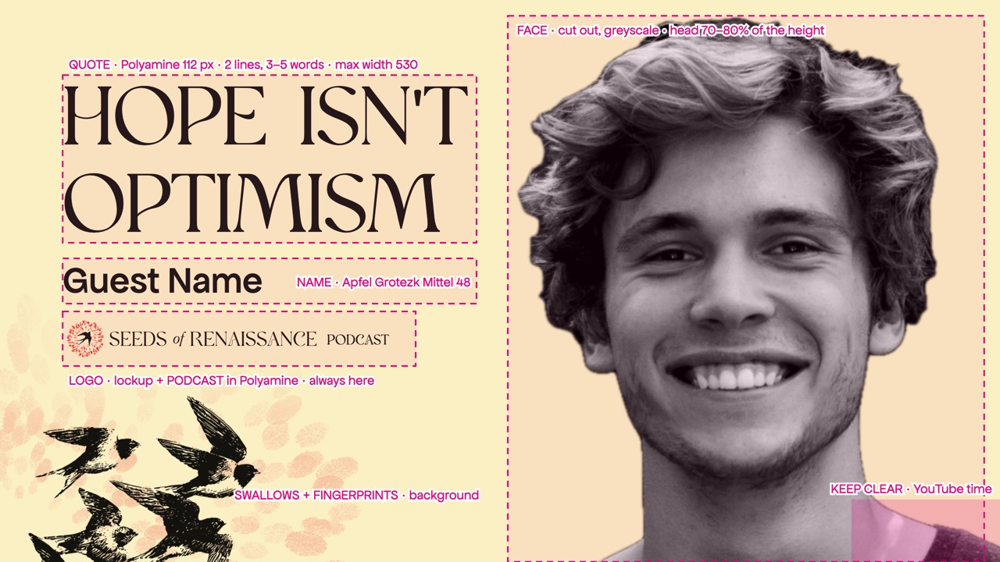
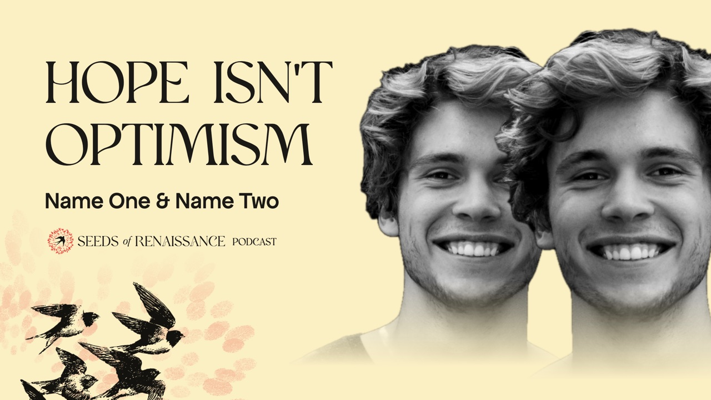
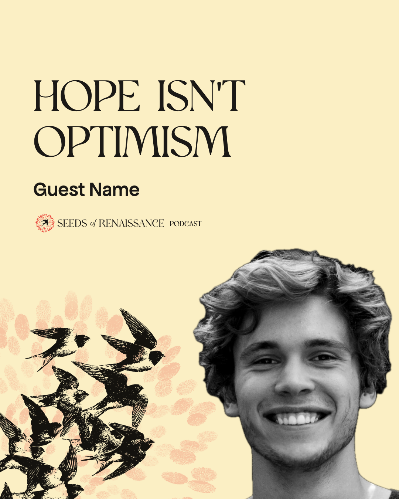
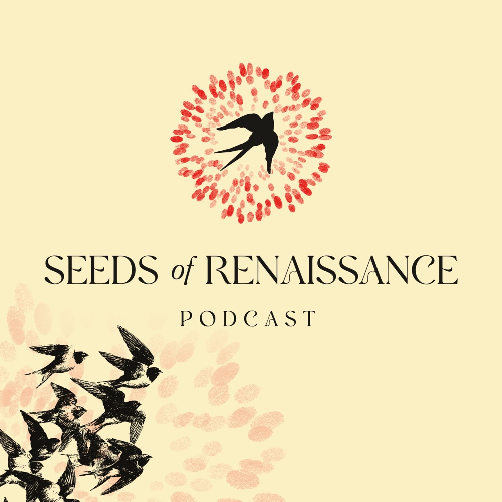
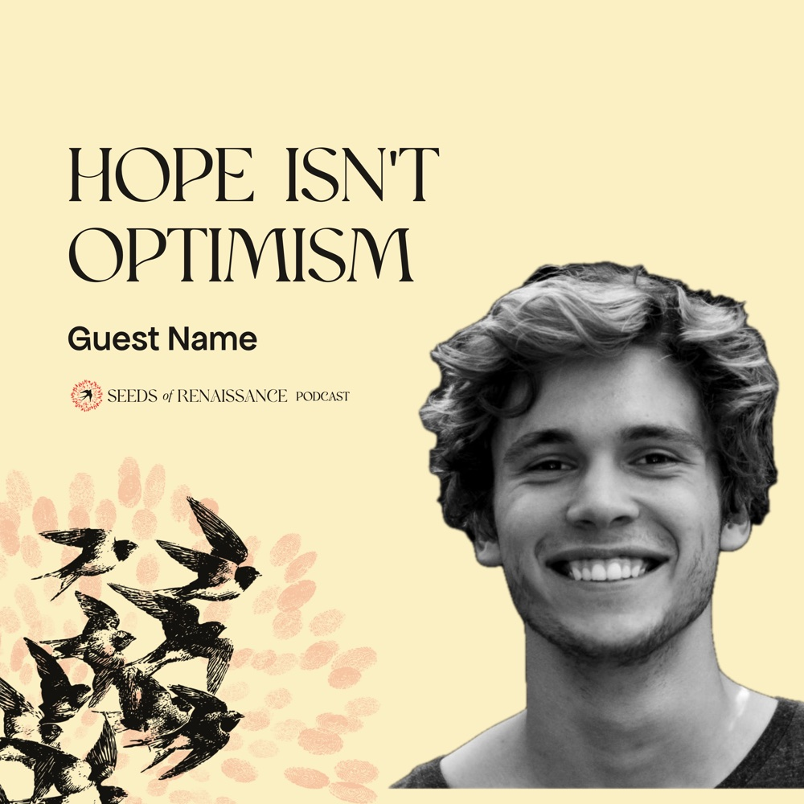

# Podcast

Every image for the Seeds of Renaissance podcast: the episode cover for YouTube, the episode posts for Instagram, and show art. Part of the [SoR design system](README.md); read [BUILD.md](BUILD.md) first. Status: [examples.md](examples.md#status) · beads `design-34t.16`.

**Final** (13 October 2026): the episode cover, the square show art and square episode art. Make an episode cover in Canva with the [podcast kit](examples/youtube/canva-kit/README.md); show art and episode art files: [examples/podcast/](examples/podcast/README.md).

## One brand, no named shows

The podcast is **Seeds of Renaissance**: one name, one feed, no named stations. *Over the Mountains* is retired as a show name (2026-10-05, see [brand.md](brand.md#names)). Kinds of episode (guest interviews, Rufus–Sylvie conversations) are formats, shown by playlist and the episode's own words, not by separate lockups. The podcast goes out on YouTube as video and on podcast apps as audio; YouTube is one channel for it ([youtube.md](youtube.md) has the channel's own specs).

## The look: swallows and fingerprints

All podcast images share one ground:

- **Sunlight**, the system's pale yellow (`--sunlight`, #fbefc4), flat. Chosen over plain white (too stark, and lost on YouTube's white page). A **paper-to-sunlight wash** (white behind the words, warm towards the bottom right) is the gentler alternative; both kits include it. Nothing behind the words.
- **The black swallows** (the woodcut flock, `system/woodcuts/elements/swallows-flock-engraving-black.png`) rising from the **bottom-left corner**, cropped by the edges so the flock is still arriving.
- **The logo's fingerprints**, without the bird (`system/img/fingerprints-red.png`), faded to **20%** around the birds and filling the corner. They fade out before they reach the words.
- **The logo**: the horizontal lockup, mark and name, straight on the ground, **no disc**. On podcast images it is followed by **PODCAST** on the same line, in Polyamine at the height of the name's capitals. It always sits **under the guest's name**.

The recipe is code in `system/swallows.py`, shared by the YouTube and Instagram kits, so both stay the same.

## The episode cover (YouTube, 1280 × 720)

| Part | Rule |
|---|---|
| **The hook** | The episode's sharpest line, three to five words, two lines. Polyamine 112 px, ink, at x 80: the left margin matches the head's crop on the right. The biggest text. Not the video title: the title carries the topic ("Iain McGilchrist on the divided brain"), the cover the hook ("We've lost the plot") |
| **The guest's name** | Apfel Grotezk Mittel 48 px (42 for two names), under the hook |
| **The logo** | The lockup with PODCAST, under the name, 330 px wide. Same place on every episode |
| **The guest** | Cut out, black and white, on the right; the head about three-quarters of the height, shoulders running off the bottom. Expressive (mid-laugh, mid-thought), eyes visible |
| **The ground** | Sunlight (or the wash), swallows and fingerprints from the bottom left, as above |
| **Keep clear** | The bottom-right corner, where YouTube shows the video length |

**Two speakers** (a conversation): one in front and slightly larger, the other just behind, turned towards each other, shoulders fading into the ground; "Name One & Name Two".

**Why it works.** People see the cover at 170–360 px wide, often on a phone, and at 168 px in "Up next". So: one focal point (the face), a few big words, and the brand as a signature rather than a message. The face does most of the work; the hook is the second read; the logo, swallows and fingerprints make the series recognisable before anyone reads it. Check every cover at about 15% zoom before downloading. Honest, not clickbait: no arrows, shock faces or extra colours.

**How to make one:** the [podcast kit](examples/youtube/canva-kit/README.md): full-size PNG layers (the ground with the logo, the guides above, placement guides for one or two guests), the Canva steps and exact positions. Download as PNG or JPG under 2 MB at 1280 × 720.

## Episode posts (Instagram)

The same ground and logo on 4:5 and 1:1 posts: the hook, the guest's name in Apfel Grotezk, the logo with PODCAST, the guest rising from the bottom right. Part of the [Instagram kit](examples/social/instagram/README.md), with quote cards, announcements and carousels on the same ground.

## Show art (3000 × 3000)

One image for the whole podcast, in Spotify, Apple Podcasts and the rest. In a podcast app everyone already knows it's a podcast, so the order flips: the mark and **SEEDS of RENAISSANCE** are big, **PODCAST** small and spaced out under them. Pure sunlight, the swallows and fingerprints from the bottom left; no guest, no episode words. At 55 px in app lists only the red mark and the black flock register, which is enough to recognise it.

## Episode art (square, 3000 × 3000)

Apple Podcasts (and Spotify for video episodes) can show a square image per episode instead of the show art. Ours is the square version of the episode cover: the same hook, name, logo with PODCAST and guest, on the same ground. It is the Instagram 1:1 podcast template exported at 3000 × 3000, so one Canva design serves both: make the 1:1 post, then download it at 3000 × 3000 for the episode. Upload it with the episode in the podcast host. Optional: if it's skipped, apps show the show art.

## What we need

| Item | Size | Status |
|---|---|---|
| Episode cover | 1280 × 720 | **Done**: the [podcast kit](examples/youtube/canva-kit/README.md) |
| Episode posts | 1080 × 1350 and 1080 × 1080 | **Done**: the [Instagram kit](examples/social/instagram/README.md) |
| Show art | 3000 × 3000, JPG or PNG, RGB | **Done**: [examples/podcast/](examples/podcast/README.md) |
| Episode art | 3000 × 3000 | **Done**: the Instagram 1:1 podcast template at 3000 px, [examples/podcast/](examples/podcast/README.md) |
| Audiogram or clip cover | 1080 × 1920 and 1080 × 1080 | Later: see [social.md](social.md) |

## Open

- **Fonts:** Polyamine (the hook, PODCAST) must be licensed before covers are published (beads `.2`); export final PNGs from a machine that has it, or from Canva once it is in the brand kit.
- **Swallow engraving:** traced from a web image with no rights cleared; re-source or redraw it.
- **Real guests:** the photo and words on the examples are placeholders.

How the cover was arrived at (versions A–D, sixteen backgrounds, the swallows versions): [archive/podcast-thumbnails-2026-10/](archive/podcast-thumbnails-2026-10/README.md).

## Next

Audiogram and clip covers (1080 × 1920 and 1080 × 1080) for short clips, on the same ground; see [social.md](social.md). Build them with `system/swallows.py` like the kits.
