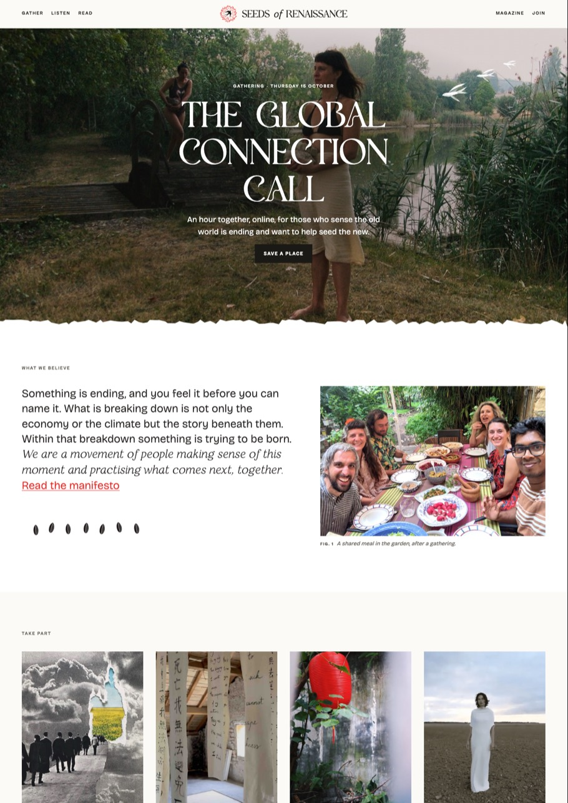
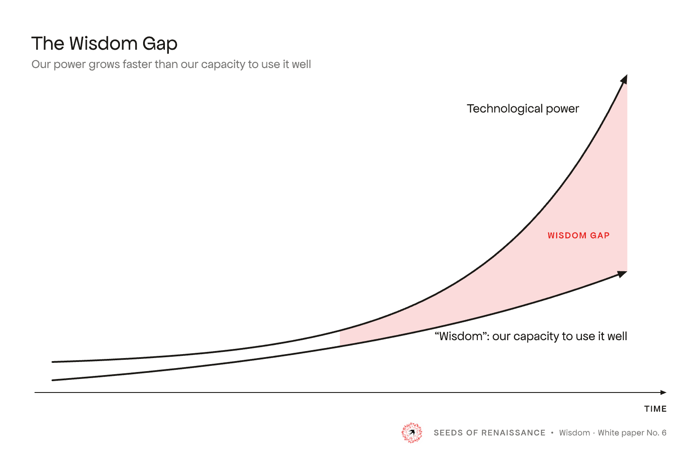

# A five-minute tour

The whole Seeds of Renaissance design system in one read, in the order a designer needs it: who we are and who we speak to, how it should feel and sound, then the logo, colour, type, graphics, layout and some finished pieces. Each part links to its own page with the full rules. To go in depth, read those pages in the order at the [end](#in-depth).

## Who we are

Seeds of Renaissance is a **vision and movement for civilisational rebirth**. We offer content and community:

- **Content: the Media House**. It helps people discover, engage with, and learn about the wisdom needed to understand, embody, and collaborate around civilisational renewal: the podcast and YouTube channel, a yearly printed magazine, essays and white papers, the manifesto and the Greenhouse Newsletter.
- **Community: Gardens of Change**, our spaces of belonging. Courses and events, community gardens and local gardens, where people connect, practise and collaborate. This is where hope turns into action.

We offer mythos and language for what is already being felt: the death of an old paradigm and the birth of a new. At heart it is a movement and a community, not a publication. It holds together intellect and art, rigour and spirituality, darkness and hope.

More: [Brand](brand.md).

## Who we speak to

Those who sense the impending death of old paradigms and long for the ideas, the practice, and the company to help birth the new, often before they can name it. They are intellectually curious and practically hungry, allergic to hype, and looking for grounded hope. Four personas: the Meaning Seeker, the Post-Disillusionment Renewer, the Awakening Professional and the Disillusioned Youth.

What they should feel: *"These people are honest. They're living it. I'm not alone in seeing what I see."*

More: [Brand: who we are here for](brand.md#who-we-are-here-for), with the four personas.

## The feel: grounded hope

<iframe class="specimen" src="specimens/feel.html" style="aspect-ratio:1000/374" loading="lazy" title="Feel, rendered"></iframe>

Every design choice is judged against one phrase: **grounded hope**. Hope is earned by going through the dark, not around it, and it leans towards dawn. Three notes support it: deep sourcing, crafted rigour and liminal integration.

The character is **a little off-centre**: earthy, a bit quirky, never mainstream. The roughness lives in texture and imperfection (paper grain, torn edges, woodcuts, fingerprints), never in muddy colour. Nothing may look backwards.

**Rigour is the form, warmth is the surface**, like a potter's bowl. The balance shifts with the register: **Study** (papers, essays) leads with rigour, **Conversation** (manifesto, podcast, magazine) balances the two, **Gathering** (community, events) leads with warmth.

**We are not** wellness or new age, luxury-clean or glossy, corporate or hard-selling, sleek and contemporary, or chaotic like many artist sites.

More: [Feel](feel.md), with the eight principles.

## Voice

**A poet-philosopher who thinks clearly.** The lyrical leads and rigour grounds it. We speak from within the moment, not above it, and people should feel held, not lectured.

- **Start from the feeling**: *Something is ending, and you feel it before you can name it.*
- **Honest, not hyped**: *We don't have the answers. We're working them out together.*
- **Concrete over abstract**: *An hour together, online, once a month*, not *a transformative space for collective emergence*.
- **Plain words on the way in.** Entry pages stay plain; the poetic voice belongs in the manifesto, magazine and art, and rigour in essays and papers.

The hero line: *For those who sense the old world is ending and want to help seed the new.*

More: [Voice](voice.md), with the key lines, register by place and rewrites.

## The logo

<iframe class="specimen" src="specimens/logo.html" style="aspect-ratio:1000/262" loading="lazy" title="Logo, rendered"></iframe>

A black swallow rising through a radiating circle of red fingerprints: many hands around a bird in flight. The main logo is the horizontal lockup, the mark beside "Seeds *of* Renaissance". The full mark is used at every size, from 16 px up.

More: [Logo](logo.md), and [every logo file](logos.md).

## Colour

<iframe class="specimen" src="specimens/colour.html" style="aspect-ratio:1000/622" loading="lazy" title="Colour, rendered"></iframe>

**Ink and paper first.** Four grounds (white, paper, sunlight, night), three inks and one accent. Colour arrives in photographs, not in the interface.

- **Buttons are ink**: black, solid or outlined.
- **Red is rare.** The logo red is only for an occasional link in running text and for footnote marks; never a button, heading or background.
- **Sunlight**, the pale yellow, is a ground for a whole section; never text or a highlight.
- **One night section per page**, plus the footer.

By area on the home page, leaving out photographs: about 64% white and paper, 14% sunlight, 16% night, 5% ink and 1% red.

More: [Colour](colour.md), with every value and the illustration inks for graphics.

## Type

<iframe class="specimen" src="specimens/type.html" style="aspect-ratio:1000/690" scrolling="no" loading="lazy" title="Type, rendered"></iframe>

Four faces, and **length decides**:

- **Polyamine** for display under about ten words: heroes, titles, headlines.
- **Restora** once display runs longer (pull quotes, long titles), and for the poetic italic.
- **Bricolage Grotesque** for all reading.
- **Apfel Grotezk** for small uppercase labels: eyebrows, buttons, dates, captions.

Polyamine and Restora are not yet licensed: where they are not installed, you see Fraunces in their place.

More: [Type](type.md), with the scale.

## Graphics

<iframe class="specimen" src="specimens/graphics.html" style="aspect-ratio:1000/880" scrolling="no" loading="lazy" title="Graphics, rendered"></iframe>

Printmade marks, slightly rough at the edge: woodcut swallows and seeds, animals, prints, painted botanicals and washes, line figures and drawn mountains. They are **punctuation, not wallpaper**: one graphic moment per section at most, and one ink per graphic. Four seeds stand for the four ways to take part: sunflower for Gather, wheat for Practise, bean for Belong, maple key for Seed.

The woodcuts are ours. The other sets are traced or cut from mood board images and are not yet cleared for public use.

More: [Graphics](graphics.md), with a gallery for each set.

## Layout

<iframe class="specimen" src="specimens/rhythm.html" style="aspect-ratio:1000/536" loading="lazy" title="Rhythm, rendered"></iframe>

**A page is a stack of full-width grounds.** Rhythm comes from changing the ground, not from boxes, borders or colour. White is the default; paper and sunlight come in between; one night section sits about two thirds of the way down. Night and light meet at a torn paper edge, never a straight line. Long text keeps to a reading width.

Photographs sit flat and square. No rounded corners, card shadows or borders around sections.

More: [Layout](layout.md), and [Components](components.md) for the parts of a page with the HTML to copy.

## Examples

Built only from the system. The photographs in them are mood board placeholders.

  <a href="examples/web/home.html" class="block no-underline">A web page: the home page</a>
  <a href="examples/print/index.html" class="block no-underline">A paper: the Wisdom white paper</a>
  <a href="podcast" class="block no-underline">A podcast episode cover</a>
  <a href="examples/diagrams/index.html#wisdom-gap" class="block no-underline">A figure for a paper</a>

More: [Examples](examples.md), every one, each with the guide for making it.

## In depth

The pages behind this tour are the in-depth version. Read them in this order:

1. [Brand](brand.md): why we exist, what we offer, who for, our names
2. [Feel](feel.md): grounded hope, the registers, the eight principles
3. [Voice](voice.md): key lines, register by place, rewrites
4. [Logo](logo.md): the mark, lockups and colourways
5. [Colour](colour.md): every ground, ink and accent, with values
6. [Type](type.md): the four faces, the scale, fallbacks and licences
7. [Graphics](graphics.md) and [Photography](photography.md): the library, its rules, and what pictures to choose
8. [Layout](layout.md) and [Components](components.md): grounds, rhythm, torn edges, and the parts of a page
9. [Examples](examples.md): finished pieces of every kind

To see everything rendered with the real CSS, open [the whole system on one page](guide.html). To make something, start from [what you're making](README.md#make-something).
